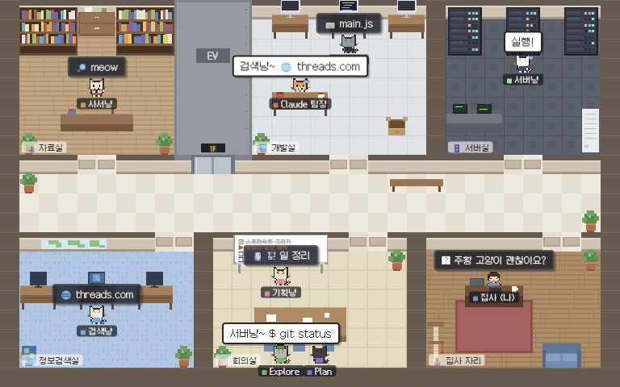
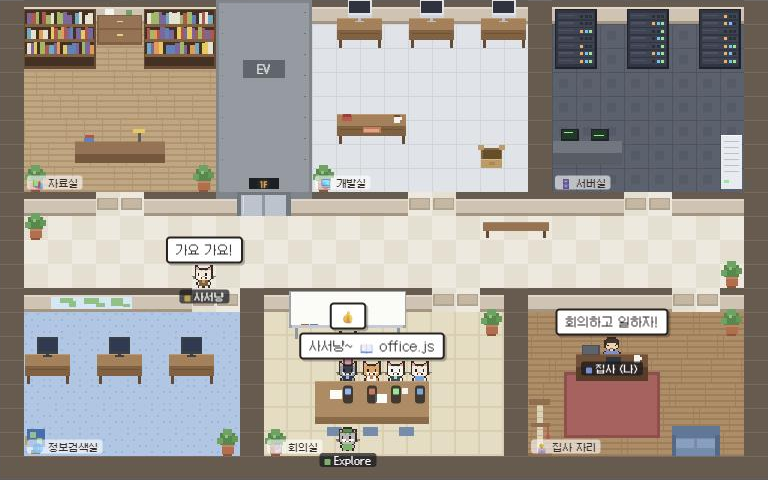

# 🐾 냥냥 오피스 (nyang-office)

Claude Code가 지금 무슨 일을 하고 있는지 **도트 고양이 사무실**로 보여 주는 로컬 대시보드입니다.

Claude 팀장냥이 자기 책상에서 일을 나눠 주면, 방마다 상주하는 담당 고양이가 📨 편지를 받아 처리하고 답장을 돌려보냅니다. 터미널과 실시간으로 함께 움직여요.



## 등장 고양이

| 방 | 담당 | 맡는 일 (Claude Code 도구) |
|---|---|---|
| 📚 자료실 | 사서냥 | `Read` `Glob` `Grep` `Skill` — 책을 펴고 읽어요 |
| 💻 개발실 | 개발냥 | `Edit` `Write` `MultiEdit` `NotebookEdit` — iMac 화면에 코드가 흘러요 |
| 🗄️ 서버실 | 서버냥 | `Bash` `PowerShell` `Monitor` — 일하는 동안 랙 불빛이 빨라져요 |
| 🌐 정보검색실 | 검색냥 | `WebSearch` `WebFetch` · MCP 도구 — 지구본 모니터가 켜져요 |
| 🗒️ 회의실 | 기획냥 | `TodoWrite` · 계획 — 화이트보드에 실제 할 일 목록이 적혀요 |
| 🧑‍💻 집사 자리 | 집사(나) | `AskUserQuestion` `ExitPlanMode` — 질문 편지가 집사 책상으로 와요 |

- **Claude 팀장냥**: 생각할 땐 턱을 괴고 💭 구름 말풍선, 서브에이전트를 부를 땐 📞 전화
- **서브에이전트**: Explore(초록 모자), Plan(안경 쓴 검은 고양이)이 엘리베이터로 출근해 회의 테이블에 앉아 일을 맡기고, 끝나면 팀장에게 보고한 뒤 "👋 퇴근합니다!"
- **실패하면**: 담당 고양이가 식은땀을 흘리며 빨간 말풍선과 빨간 답장을 보내요
- **한가하면**: 담당 고양이는 방을 어슬렁거리고, 복도를 산책하고, 한가한 친구에게 놀러 가 수다를 떨어요("츄르 먹을래?" → "좋아냥!"). 그러다 일 편지가 오면 "바로 갈게냥! 💨" 하고 책상으로 뛰어가요. 한참 한가하면 자리로 돌아가 졸아요.
- **팀장냥이 쉴 때**는 [`idle.js`](public/js/idle.js) 규칙대로 쉬어요

### 회의

필요한 순간에 한가한 고양이들이 회의실 테이블로 모여요. 기획냥은 화이트보드 앞에서 발표하고, 다른 고양이들이 돌아가며 한마디씩 해요. 회의 중에 일 편지를 받은 고양이는 회의를 빠져나가 일하러 가요.

| 회의 | 언제 | 누가 |
|---|---|---|
| 📢 킥오프 회의 | 집사가 새 요청을 보냈을 때 | Claude 팀장 + 한가한 담당들 |
| 🗒️ 계획 회의 | 할 일 목록이 새로 짜였을 때 | 〃 |
| 🚨 긴급 회의 | 30초 안에 실패가 두 번 났을 때 | 〃 |
| 🍵 티타임 | 한동안 아무 일이 없을 때 가끔 | 담당 고양이들끼리 |

일 회의는 40초에 한 번까지만 열려요(긴급 회의는 예외).



## 층별 안내

한 폴더에서 전혀 다른 일을 해도 섞이지 않도록, 층은 폴더가 아니라 **작업** 단위로 나눠요. 그 작업의 세션들이 층 안의 **매장**이에요.

1. **앱 사이드바 그룹**에 넣은 세션은 그룹 이름 층으로 모여요. 직접 묶고 싶을 때 써요.
2. 그 밖에는 Claude 데스크톱 앱의 **세션 이름**이 같은 것끼리 한 층이에요. `(fork)`처럼 갈라져 나온 세션은 원래 작업 층에 합쳐요.
3. 앱이 모르는 기록(터미널에서 쓴 세션 등)은 폴더 층으로 가고, 같은 폴더에 작업 층이 따로 있으면 "폴더 · 기타 기록"이라고 표시해요.

- 한 번 알아낸 "기록 → 층" 연결은 `.floors-cache.json`에 기억해 둬서, `/clear` 뒤에 앱이 예전 기록을 잊어도 원래 층에 남아요.
- 기본은 가장 최근에 움직인 세션을 자동으로 따라가요. 층을 누르면 그 층의 최신 세션을, 매장을 누르면 그 세션을 고정해서 봐요.
- 층을 누르면 "▲ 3F" 엘리베이터 표시등이 뜨면서 그 층 사무실로 이동해요.

## 실행

Node.js 18 이상만 있으면 됩니다. 설치할 패키지는 없어요.

```bash
git clone https://github.com/LimQQ/nyang-office.git
cd nyang-office
node server.js
```

브라우저에서 <http://127.0.0.1:4777> 을 열어요. 기록 없이 구경만 하려면 <http://127.0.0.1:4777/?demo>.

## Claude Code 세션이 시작될 때 자동 실행 (선택)

`~/.claude/settings.json`에 SessionStart 훅을 추가하면, Claude Code 세션을 열 때 사무실이 저절로 켜져요.

```json
{
  "hooks": {
    "SessionStart": [
      {
        "hooks": [
          {
            "type": "command",
            "command": "node \"/절대/경로/nyang-office/start-office.js\"",
            "async": true,
            "timeout": 15
          }
        ]
      }
    ]
  }
}
```

- [`start-office.js`](start-office.js)는 서버가 **꺼져 있을 때만** 백그라운드로 켜고 브라우저를 한 번 열어요. 세션을 여러 개 열어도 탭이 늘어나지 않아요.
- 브라우저 없이 서버만 켜려면 명령 끝에 `--no-open`을 붙여요.
- 무슨 일이 있었는지는 `office.log`(훅), 서버 오류는 `server.log`에 남아요.

## 어떻게 동작하나

1. [`server.js`](server.js)가 `~/.claude/projects/**/*.jsonl`(Claude Code 세션 기록)을 0.25초마다 따라 읽어요. 마지막으로 읽은 바이트 위치만 기억해 새로 붙은 줄만 읽고, 덜 써진 줄은 바이트 그대로 남겨 한글이 깨지지 않게 해요.
2. 도구 호출·결과·생각·서브에이전트 출퇴근을 작은 이벤트로 바꿔 SSE(`/events`)로 브라우저에 보내요.
3. 서브에이전트 기록(`<세션>/subagents/agent-*.jsonl`)은 첫 프롬프트를 비교해 어떤 `Agent` 호출인지 짝지어요.
4. 데스크톱 앱의 세션 파일(`claude-code-sessions/**/local_*.json`)에서 `title`·`cliSessionId`·`cwd`를, 앱 설정 파일에서 사이드바 그룹 이름과 소속만 읽어 층을 나눠요.
5. 브라우저는 16×16 문자열 지도로 정의한 도트 스프라이트를 캔버스에 그려요. 외부 이미지 파일은 없어요.

**프라이버시**: 토큰을 쓰지 않고, Claude Code 설정을 바꾸지 않으며(자동 실행은 선택), `127.0.0.1`에서만 열리고 기록을 밖으로 보내지 않아요. 외부에서 받는 건 [Galmuri](https://github.com/quiple/galmuri) 픽셀 폰트(CDN)뿐이에요.

## 파일 구조

```
server.js           세션 기록 tail + SSE 서버
start-office.js     자동 실행용 스크립트 (SessionStart 훅)
public/
  index.html        화면 틀
  style.css         층별 안내 · 말풍선 · 업무 일지
  js/main.js        고양이 행동 · 편지 주고받기 · 층 이동
  js/office.js      사무실 지도 · 가구 · 길찾기
  js/sprites.js     16×16 도트 스프라이트와 고양이 생김새
  js/idle.js        팀장냥이 쉴 때 할 일 (직접 꾸미기)
  js/demo.js        데모 각본
```

## 직접 꾸미기

- **쉬는 시간**: [`public/js/idle.js`](public/js/idle.js)의 `chooseIdleActivity(idleSec, ctx)`가 `'desk'` `'groom'` `'wander'` `'nap'` 중 하나를 돌려주면 팀장냥이 그대로 행동해요.
- **수동 테스트**: `/?demo&manual`을 열고 브라우저 콘솔에서
  ```js
  office.handle({ k: 'tool', a: 'main', id: 't1', tool: 'Read', label: '📖 server.js' });
  office.advance(2); // 시간 2초 빨리 감기
  ```
- **환경 변수**: `PORT`(기본 4777), `CLAUDE_PROJECTS`(세션 기록 폴더), `CLAUDE_APP_SESSIONS`(데스크톱 앱 세션 폴더)

## 아이디어 출처

Threads [@cowboy76](https://www.threads.com/@cowboy76/post/DeqgY7wiJYa) 님이 소개한 "Claude Code 사무실"에서 영감을 받아, 방마다 담당 고양이가 편지를 주고받는 도트 고양이 버전으로 새로 만들었어요.
